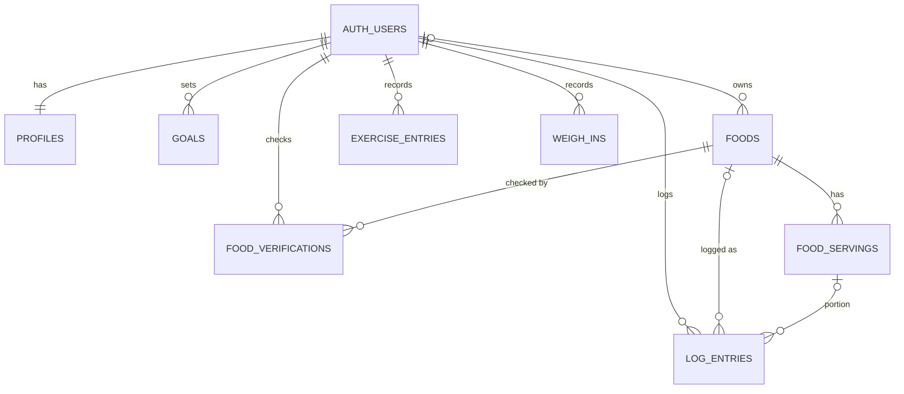

# Database schema

Tally's data lives in Supabase Postgres. The schema is defined by migrations in [`supabase/migrations/`](../supabase/migrations/). This doc is a readable summary; the SQL is the source of truth, and [`src/types/database.ts`](../src/types/database.ts) (generated with `npm run db:types`) is the source of truth for column names in app code.

## ER diagram



## Tables

| Table                 | Purpose                                                                                                                                                                                                               |
| --------------------- | --------------------------------------------------------------------------------------------------------------------------------------------------------------------------------------------------------------------- |
| `profiles`            | One per user, created by trigger at sign-up. Body stats, `unit_system`, `timezone`, `numbers_off`, weigh-in schedule (`weigh_in_weekday` is 0 = Sunday … 6), and `onboarded_at`.                                      |
| `goals`               | Goal type, start/target weight, pace, daily calorie and macro targets. **One active goal per user** (`ended_at is null`, enforced by a unique index). The app changes goals only through `change_goal()` (see below). |
| `foods`               | Every food: global (Open Food Facts, restaurants) and user-created (`user_product`, `user_recipe`, `label_scan`). `owner_id` + `visibility` (`private` / `public`) decide who sees it.                                |
| `food_servings`       | Named portions of a food. `base_multiplier` = how many of the food's base amounts the portion is. At most one `is_default` per food.                                                                                  |
| `food_verifications`  | One row per (food, user): "Does this match your label?" A trigger keeps `foods.verification_count` / `mismatch_count` in sync.                                                                                        |
| `log_entries`         | Food log entries with `local_date`, `meal`, `quantity`, and a snapshot of the name and nutrition at log time.                                                                                                         |
| `exercise_entries`    | Exercise from Apple Health or entered manually, with `local_date`. `(user_id, external_id)` is unique so HealthKit sync is idempotent.                                                                                |
| `weigh_ins`           | Weight (and optional body-fat %) measurements, with `local_date`.                                                                                                                                                     |
| `daily_totals` (view) | Per user and `local_date`: entry count and summed calories / protein / carbs / fat from `log_entries`. `security_invoker`, so RLS on `log_entries` applies.                                                           |

## Conventions

- **Units:** stored metric (kg, cm, g, mg). The app converts to and from imperial for display using `profiles.unit_system`.
- **Nutrients:** `foods` stores nutrients **per `base_amount` of `base_unit`**: 100 g (or ml) for packaged foods, 1 serving for recipes. Common label nutrients have columns (`fiber_g`, `sugar_g`, `sat_fat_g`, `sodium_mg`, `cholesterol_mg`); anything else goes in the `micros` jsonb, keyed by snake_case name plus unit (e.g. `potassium_mg`, `vitamin_d_mcg`).
- **Local dates:** `local_date` is the calendar day in the user's `profiles.timezone` when the entry was made. Day views, totals, and streaks use it rather than timestamps.

### log_entries: the snapshot

The app computes the snapshot when logging, so editing or deleting a food never rewrites history:

- `calories` / `protein_g` / `carbs_g` / `fat_g` = food value × `food_servings.base_multiplier` × `quantity`
- other nutrients go in the `nutrients` jsonb
- `food_name` is copied from the food

`food_id` and `serving_id` are set null if the food or serving is deleted. They're also null for Open Food Facts results that aren't cached in `foods` yet (see below).

## Security

**Row Level Security is enabled on every table.** All policies are for the `authenticated` role.

| Table                                                   | Policies                                                                                                                                                                                                                                                                   |
| ------------------------------------------------------- | -------------------------------------------------------------------------------------------------------------------------------------------------------------------------------------------------------------------------------------------------------------------------- |
| `profiles`                                              | Select and update own row. No client insert or delete: rows are created by trigger and removed by cascade.                                                                                                                                                                 |
| `goals`, `log_entries`, `exercise_entries`, `weigh_ins` | All operations on own rows.                                                                                                                                                                                                                                                |
| `foods`                                                 | Select public foods and own foods. Insert only with `owner_id` = self and source `user_product`, `user_recipe`, or `label_scan`. Update only own `user_recipe` foods. Delete only own private foods. Column grants keep `verification_count` / `mismatch_count` read-only. |
| `food_servings`                                         | Read servings of readable foods. Add to own foods. Edit or delete servings of own private foods or recipes.                                                                                                                                                                |
| `food_verifications`                                    | Read all. Insert own answer for someone else's public food. Update or delete own answer.                                                                                                                                                                                   |

Open Food Facts and restaurant foods can only be written with the service role. **TODO:** an Edge Function will cache OFF results in `foods`; until then the app shows them uncached and logs them with `food_id = null`.

### goals: changing goals

`public.change_goal(p_goal_type, p_start_weight_kg, p_daily_calorie_target, …)` ends the caller's active goal (sets `ended_at = now()`) and inserts the new one **in one transaction**, returning the new row. The two steps succeed or fail together, so a user is never left without an active goal. The app uses it for the first goal at onboarding (there's no old goal to end) and for every later change, via `supabase.rpc('change_goal', …)`.

It's `security invoker`, so RLS on `goals` still applies. It raises `42501` when there's no signed-in user, and only `authenticated` can execute it.

## Triggers

| Trigger                                  | What it does                                                                          |
| ---------------------------------------- | ------------------------------------------------------------------------------------- |
| `on_auth_user_created` (on `auth.users`) | Creates the user's `profiles` row.                                                    |
| `on_auth_user_deleted` (on `auth.users`) | Deletes the user's private foods. Their public foods stay (with `owner_id` set null). |
| `food_verifications_counts`              | Recomputes `foods.verification_count` / `mismatch_count`.                             |
| `foods_reset_verifications`              | Clears a food's verifications when its nutrition changes.                             |

Trigger functions are `security definer` and not executable by `anon` / `authenticated`.

## Workflow

```bash
npx supabase migration new <name>   # create a new migration file
npx supabase db reset               # local only: rebuild from migrations + seed.sql (needs Docker)
npx supabase db push                # apply pending migrations to the linked project
npm run db:types                    # regenerate src/types/database.ts from the linked project
npm run db:types:local              # …or from the local database
```

Never edit an applied migration. Add a new one instead.
