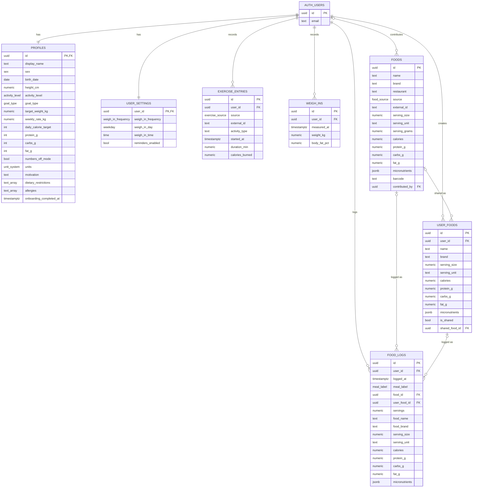

# Database schema

Tally's data lives in Supabase Postgres. The schema is defined by migrations in [`supabase/migrations/`](../supabase/migrations/). This doc is a readable summary; the SQL is the source of truth.

## ER diagram



Every table also has `created_at` and `updated_at` (omitted above for space).

## Conventions

- **Keys:** uuid primary keys (`gen_random_uuid()`). `profiles` and `user_settings` use the auth user's id as their key.
- **Timestamps:** `created_at` / `updated_at` on every table. `updated_at` is maintained by the `set_updated_at` trigger.
- **Units:** stored metric (`height_cm`, `weight_kg`, `weekly_rate_kg`). `profiles.units` only controls display.
- **Nutrition:** values are **per serving** (`serving_size` + `serving_unit`, with optional `serving_grams`). A log's totals are `nutrient × servings`.
- **Micronutrients:** a jsonb object keyed by snake_case name plus unit, e.g. `{"sodium_mg": 74, "fiber_g": 3.1}`. Common keys are `sodium_mg`, `cholesterol_mg`, `fiber_g`, `sugar_g`, `saturated_fat_g`, `trans_fat_g`, `potassium_mg`, `calcium_mg`, `iron_mg`, `vitamin_d_mcg`, `magnesium_mg`, and `zinc_mg`. Unknown keys are allowed.

## Tables

| Table              | Purpose                                                                                                               |
| ------------------ | --------------------------------------------------------------------------------------------------------------------- |
| `profiles`         | One per user: body stats, goal, targets, display preferences, onboarding state.                                       |
| `user_settings`    | One per user: weigh-in reminder schedule (default weekly, Sunday, 08:00).                                             |
| `foods`            | Global food database: Open Food Facts, restaurants, manually curated, and user-shared foods.                          |
| `user_foods`       | A user's private "My Foods". `is_shared` / `shared_food_id` track sharing to `foods`.                                 |
| `food_logs`        | Food entries with a timestamp and meal label, plus a snapshot of the food's name and nutrition at log time.           |
| `exercise_entries` | Exercise from Apple Health or entered manually. `(user_id, external_id)` is unique to make HealthKit sync idempotent. |
| `weigh_ins`        | Weight (and optional body-fat %) measurements.                                                                        |

### food_logs: source and snapshot

- A log points at **either** a global food (`food_id`) **or** a user food (`user_food_id`). A `BEFORE INSERT` trigger requires exactly one on insert.
- If the source food is later deleted, its FK is set to null and the log keeps its snapshot. So a check constraint allows "at most one" source after insert.
- The snapshot columns (`food_name`, `serving_size`, `calories`, …) are copied when the food is logged, so editing a food never rewrites history.

## Search

`pg_trgm` GIN indexes on `foods.name`, `foods.brand`, and `user_foods.name` support fast `ilike '%term%'` and similarity search.

## Security

**Row Level Security is enabled on every table.**

| Table                                         | Policies (role `authenticated`)                                                                                                       |
| --------------------------------------------- | ------------------------------------------------------------------------------------------------------------------------------------- |
| `profiles`, `user_settings`                   | Select and update own row. Rows are created by trigger and deleted by cascade, so there's no client insert or delete.                 |
| `user_foods`, `exercise_entries`, `weigh_ins` | Select, insert, update, delete own rows.                                                                                              |
| `food_logs`                                   | Same, and a referenced `user_food_id` must also belong to the user.                                                                   |
| `foods`                                       | Select for any signed-in user. **No client write policies.** Inserts will go through a future server function using the service role. |

## Triggers

| Trigger                                  | What it does                                                                                          |
| ---------------------------------------- | ----------------------------------------------------------------------------------------------------- |
| `on_auth_user_created` (on `auth.users`) | Creates the user's `profiles` and `user_settings` rows (`security definer`, not callable by clients). |
| `*_set_updated_at`                       | Bumps `updated_at` on every update.                                                                   |
| `food_logs_require_source`               | Rejects inserts without exactly one of `food_id` / `user_food_id`.                                    |

## Account deletion

Every user-owned table references `auth.users(id) on delete cascade`. Deleting the auth user removes their profile, settings, foods, logs, exercise, and weigh-ins. Global `foods` they contributed are kept with `contributed_by` set to null (anonymized), as described in [PRODUCT.md](PRODUCT.md#accounts-and-sync).

## Workflow

```bash
npx supabase migration new <name>   # create a new migration file
npx supabase db reset               # local only: rebuild from migrations + seed.sql (needs Docker)
npx supabase db push                # apply pending migrations to the linked project
npm run db:types                    # regenerate src/types/database.ts from the linked project
npm run db:types:local              # …or from the local database
```

Never edit an applied migration. Add a new one instead.
